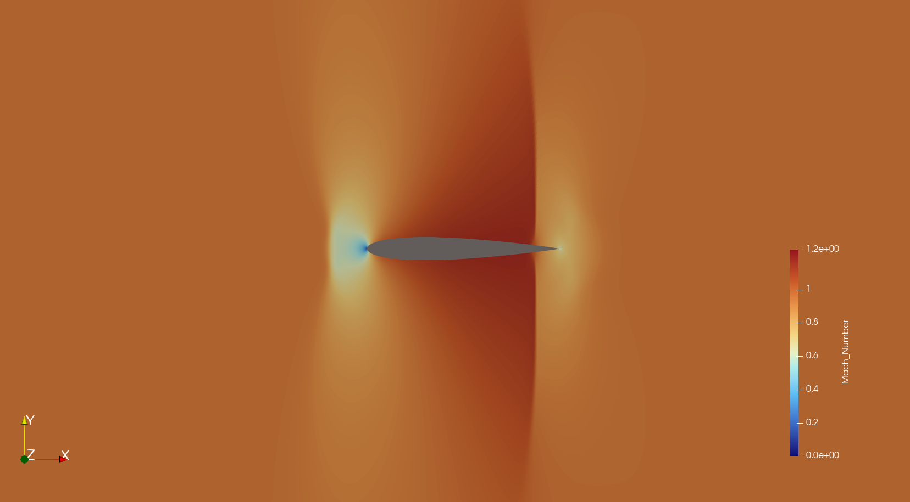

# RustPotential - Full Potential CFD Solver in Rust

[](https://opensource.org/licenses/MIT)
[](https://www.rust-lang.org/)

An efficient, high-fidelity 2D Computational Fluid Dynamics (CFD) solver for the **Full Potential Equation** in conservative form, developed in **Rust**. The solver is designed for structured O-grid topologies over symmetric and arbitrary 2D airfoils (including lifting flows at non-zero Angle of Attack), employing the **Holst Artificial Density** scheme for shock capturing and the **AF2 (Approximate Factorization 2)** algorithm with cyclic Thomas (Sherman-Morrison) elimination for rapid convergence in subsonic and transonic flow regimes.

---

## Table of Contents
1. [Overview](#overview)
2. [Theoretical Briefing](#theoretical-briefing)
   - [Governing Equations](#governing-equations)
   - [Generalized Curvilinear Metrics](#generalized-curvilinear-metrics)
   - [Isentropic Flow Relations](#isentropic-flow-relations)
   - [Holst Artificial Density Scheme](#holst-artificial-density-scheme)
   - [AF2 Numerical Scheme on O-Grids](#af2-numerical-scheme-on-o-grids)
   - [Alpha Cycle & Dynamic Beta Control](#alpha-cycle--dynamic-beta-control)
   - [Circulation ($\Gamma$) & Lifting Flow Analysis (Non-Zero AoA)](#circulation-gamma--lifting-flow-analysis-non-zero-aoa)
   - [Aerodynamic Force Integration ($C_l, C_d$)](#aerodynamic-force-integration-c_l-c_d)
3. [Project File Structure](#project-file-structure)
4. [Compilation & Execution](#compilation--execution)
5. [Configuration & Examples](#configuration--examples)
6. [Post-Processing & Visualization](#post-processing--visualization)
7. [Academic Disclaimer & License](#academic-disclaimer--license)

---

## Overview

The Full Potential equation models compressible, inviscid, irrotational, and isentropic flow:
- Capable of modeling subsonic, critical, and transonic flows with weak shock waves ($M_1 \le 1.3$).
- **Full Lifting Flow Support ($\text{AoA} \neq 0^\circ$)**: Implements circulation ($\Gamma$) via a trailing-edge branch cut on the O-grid, Kutta condition enforcement, compressible Prandtl-Glauert farfield point-vortex correction, and implicit AF2 wake-cut jump coupling.
- Solved in **strong conservative form** to guarantee mass conservation across captured shock discontinuities.
- Implemented with **zero heap allocation** in the inner iteration loops using pre-allocated cyclic tridiagonal buffers.
- Written in clean, safe, modern Rust leveraging the `ndarray` library.
- Outputs .vtk file format to be visualized in Paraview.\



---

## Theoretical Briefing

### Governing Equations

In Cartesian coordinates, the steady 2D full potential equation is written as:

$$\frac{\partial (\rho \phi_x)}{\partial x} + \frac{\partial (\rho \phi_y)}{\partial y} = 0$$

where $\phi$ is the complete velocity potential ($\vec{q} = \nabla \phi = u \hat{i} + v \hat{j}$).

To handle arbitrary aerodynamic geometries conforming to body surfaces, the physical domain $(x, y)$ is mapped to a uniform computational domain $(\xi, \eta)$. The strong conservative formulation in curvilinear coordinates is:

$$\frac{\partial}{\partial \xi} \left( \frac{\rho U}{J} \right) + \frac{\partial}{\partial \eta} \left( \frac{\rho V}{J} \right) = 0$$

where:
- $U$ and $V$ are the **contravariant velocity components**:
  $$U = A_1 \phi_\xi + A_2 \phi_\eta$$
  $$V = A_2 \phi_\xi + A_3 \phi_\eta$$
- $J$ is the **transformation Jacobian**:
  $$J = \frac{1}{x_\xi y_\eta - x_\eta y_\xi}$$
- $A_1, A_2, A_3$ are the **metric coefficients**:
  $$A_1 = \xi_x^2 + \xi_y^2, \quad A_2 = \xi_x \eta_x + \xi_y \eta_y, \quad A_3 = \eta_x^2 + \eta_y^2$$

### Generalized Curvilinear Metrics

Using the inverse coordinate transformation matrix:

$$H^{-1} = \begin{bmatrix} x_\xi & x_\eta \\ y_\xi & y_\eta \end{bmatrix}$$

The metric derivatives are evaluated through finite differences on the grid:

$$\xi_x = J y_\eta, \quad \xi_y = -J x_\eta, \quad \eta_x = -J y_\xi, \quad \eta_y = J x_\xi$$

### Isentropic Flow Relations

Velocities and densities are non-dimensionalized by critical sound speed $a^*$ and stagnation density $\rho_t$:

$$\rho = \left[ 1 - \frac{\gamma - 1}{\gamma + 1} q^2 \right]^{\frac{1}{\gamma - 1}} = \left[ 1 - \frac{\gamma - 1}{\gamma + 1} (U \phi_\xi + V \phi_\eta) \right]^{\frac{1}{\gamma - 1}}$$

The local Mach number is computed from:

$$M = \sqrt{ \frac{2}{\gamma + 1} \frac{q^2}{1 - \frac{\gamma - 1}{\gamma + 1} q^2} }$$

### Holst Artificial Density Scheme

To capture shock waves stably and prevent non-physical expansion shocks in locally supersonic regions ($M > 1$), an upwind bias is introduced through an artificial density ($\tilde{\rho}$ on $\xi$-faces, $\bar{\rho}$ on $\eta$-faces):

$$\tilde{\rho}_{i+1/2, j} = (1 - \nu) \rho_{i+1/2, j} + \nu \rho_{i+r+1/2, j}$$

$$\bar{\rho}_{i, j+1/2} = (1 - \nu) \rho_{i, j+1/2} + \nu \rho_{i, j+s+1/2}$$

where $r = \mp 1$ depending on $\text{sign}(U)$, $s = \mp 1$ depending on $\text{sign}(V)$, and the sonic transition switch $\nu$ is:

$$\nu = \max \left( 0, (C_1 - \rho) C_2 C \right) \quad \text{with} \quad C_1 = \left( \frac{2}{\gamma + 1} \right)^{\frac{1}{\gamma - 1}}$$

### AF2 Numerical Scheme on O-Grids

The iteration scheme is written in delta form:

$$N C_{i, j}^n + \omega L(\phi^n)_{i, j} = 0, \quad \text{where } C_{i, j}^n = \phi_{i, j}^{n+1} - \phi_{i, j}^n$$

For O-grid topologies, $\eta$ is directed radially from the Farfield ($j = 0$) to the Airfoil Wall ($j = j_{\max} - 1$). The operator $N$ is split along $\eta$ to ensure positive temporal dissipation:

$$N = -\frac{1}{\alpha} \left( \alpha - \overrightarrow{\delta}_\eta A_j \right) \left( \alpha \overleftarrow{\delta}_\eta - \overrightarrow{\delta}_\xi A_i \overleftarrow{\delta}_\xi \pm \alpha \beta \overrightarrow{\overleftarrow{\delta}}_\xi \right)$$

This yields a two-step alternating factorization:

1. **Step 1 (Radial Sweep in $\eta$)**:

   $$\left( \alpha - \overrightarrow{\delta}_\eta A_j \right) f_{i, j} = \alpha \omega L(\phi^n)_{i, j}$$

   Because $\overrightarrow{\delta}_\eta$ is a forward operator, the sweep marches backwards from the wall ($j = j_{\max} - 1$) down to the farfield ($j = 1$), initialized with the solid-wall condition $f_{i, NY+1} = 0$.

2. **Step 2 (Azimuthal Sweep in $\xi$)**:

   $$\left( \alpha \overleftarrow{\delta}_\eta - \overrightarrow{\delta}_\xi A_i \overleftarrow{\delta}_\xi \pm \alpha \beta \overrightarrow{\overleftarrow{\delta}}_\xi \right) C_{i, j} = f_{i, j}$$

   Solved ring-by-ring from $j = 1$ to $j = j_{\max} - 1$. The cyclic tridiagonal boundary condition across the periodic wake cut ($i = 0 \leftrightarrow i = i_{\max} - 1$) is resolved using the **Sherman-Morrison formula**.

### Alpha Cycle & Dynamic Beta Control

- **$\alpha$-Sequence**: Convergence is accelerated across the error frequency spectrum using a geometric progression:
  $$\alpha_k = \alpha_H \left( \frac{\alpha_L}{\alpha_H} \right)^{\frac{k - 1}{M - 1}}, \quad k = 1, \dots, M$$
  where $\alpha_H = 1/\Delta s_{\min}$ damps high frequencies and $\alpha_L = 1.0$ clears low-frequency errors.
- **Dynamic $\beta$**: In supersonic zones, temporal damping $\beta_{\text{sup}}$ dynamically self-adjusts every $M$ iterations based on residual history:
  $$R_t^n = \frac{\text{RMS}^n}{\text{RMS}^{n-M}} + \frac{\text{Max}^n}{\text{Max}^{n-M}}$$

### Circulation ($\Gamma$) & Lifting Flow Analysis (Non-Zero AoA)

By D'Alembert's paradox, purely single-valued potential flow around a closed contour produces zero net lift. To enable lifting flow analysis at non-zero Angle of Attack ($\text{AoA} = \alpha$), **circulation ($\Gamma$)** is introduced into the O-grid formulation via a branch cut extending from the airfoil trailing edge ($j = NY$) to the farfield boundary ($j = 1$) along the periodic seam ($i = 1 \leftrightarrow i = NX$):

1. **Inclined Freestream Initialization**:
   $$\phi_\infty(x, y) = u_\infty x + v_\infty y, \quad \text{with} \quad u_\infty = q_\infty \cos\alpha, \quad v_\infty = q_\infty \sin\alpha$$

2. **Wake Branch-Cut Potential Jump**:
   Across the branch cut, all physical flow derivatives and thermodynamic quantities ($\vec{q}, U, V, \rho, M, p$) remain strictly continuous and single-valued, while the velocity potential $\phi$ is multi-valued with a jump equal to the bound circulation $\Gamma^n$:
   $$\Gamma^n = \phi_{\text{lower}} - \phi_{\text{upper}} \implies \phi^n_{1, j} = \phi^n_{NX, j} + \Gamma^n, \qquad \phi^n_{NX+1, j} = \phi^n_{2, j} - \Gamma^n$$

3. **Trailing-Edge Kutta Condition & Under-Relaxation**:
   To prevent flow around the sharp trailing edge, the tangential velocity in the $\xi$-direction is forced to zero at the trailing edge ($(\phi_\xi)_{NX, NY} = 0$). Using central differences across the branch cut gives the raw circulation estimate $\tilde{\Gamma}^n$:
   $$\tilde{\Gamma}^n = \phi^n_{2, NY} - \phi^n_{NX-1, NY}$$
   To stabilize the non-linear coupling between the circulation jump and the AF2 potential updates, $\tilde{\Gamma}^n$ is under-relaxed ($R_g \cong 0.5$) and blended with a linear temporal extrapolation from previous iterations:
   $$\bar{\Gamma}^n = R_g \tilde{\Gamma}^n + (1 - R_g) \Gamma^{n-1}$$
   $$\Gamma^n_{\text{est}} = 2\Gamma^{n-1} - \Gamma^{n-2}$$
   $$\Gamma^n = \frac{1}{2} \left( \bar{\Gamma}^n + \Gamma^n_{\text{est}} \right)$$

4. **Compressible Farfield Vortex Boundary Condition ($j = 0$)**:
   On the outer boundary, the Dirichlet potential superposes the inclined uniform freestream with a compressible point vortex placed at the airfoil quarter-chord $(x_{1/4}, y_{1/4}) = (0.25, 0)$:
   $$\phi_{i, 1} = (u_\infty x + v_\infty y) - \frac{\Gamma^n}{2\pi} \tan^{-1}\left( \sqrt{1 - M_\infty^2} \, \frac{y - y_{1/4}}{x - x_{1/4}} \right)$$
   where the quadrant-preserving $\text{atan2}$ angle is normalized to $[0, 2\pi)$ aligned with the trailing-edge branch cut.

5. **Implicit AF2 Coupling Across the Branch Cut**:
   In Step 2 of the AF2 scheme ($\xi$-sweep), the potential correction $C^n_{i, j} = \phi^{n+1}_{i, j} - \phi^n_{i, j}$ inherits the incremental circulation jump across the cut:
   $$C^n_{1, j} - C^n_{NX, j} = C^n_{2, j} - C^n_{NX+1, j} = \Delta \Gamma^n \cong \Gamma^n - \Gamma^{n-1}$$
   These coupling terms are injected directly into the first and last rows ($i = 2$ and $i = NX$) of the cyclic tridiagonal system before solving with the Sherman-Morrison formula.

6. **Solid Wall Boundary Condition ($j = j_{\max} - 1$)**:
   Flow tangency condition $V = 0 \implies \phi_\eta = -\frac{A_2}{A_3} \phi_\xi$. Mass flux across the wall is enforced via linear flux reflection:
   $$\Delta \text{Flux}_\eta = -2 \left( \frac{\bar{\rho} V}{J} \right)_{i, NY - 1/2}$$

### Aerodynamic Force Integration ($C_l, C_d$)

Upon convergence, the local wall pressure coefficient $C_p$ is evaluated from the isentropic density ratio:

$$C_p = \frac{2}{\gamma M_\infty^2} \left[ \left( \frac{\rho}{\rho_\infty} \right)^\gamma - 1 \right]$$

Integrating $C_p$ around the closed airfoil contour (unit chord $c = 1$) yields the normal ($C_n$) and axial ($C_a$) force coefficients, which are projected into the wind axes to obtain the lift ($C_l$) and inviscid pressure/wave drag ($C_d$) coefficients:

$$C_n = \oint C_p \, dx, \qquad C_a = -\oint C_p \, dy$$

$$C_l = C_n \cos\alpha - C_a \sin\alpha, \qquad C_d = C_n \sin\alpha + C_a \cos\alpha$$

The solver also reports the theoretical Kutta-Joukowski lift coefficient $C_{l,\text{KJ}} = \frac{2\Gamma}{q_\infty}$ for direct verification against surface pressure integration.

---

## Project File Structure

```text
RustPotential/
├── Cargo.toml               # Rust package manifest & dependencies
├── job_config.toml          # Simulation configuration (TOML)
├── README.md                # Project documentation & theoretical background
├── RustPotential.exe       # Standalone compiled release binary
├── mesh/                    # Structured 2D O-grid meshes (.vtk)
│   ├── biconvex_mesh.vtk         # Parabolic biconvex airfoil (213 x 65)
│   ├── biconvex_fine_mesh.vtk    # Fine biconvex mesh
│   ├── naca0012_mesh.vtk         # NACA 0012 airfoil (93 x 15)
│   └── naca0012_fine_mesh.vtk    # Fine NACA 0012 mesh (713 x 150)
├── job_files/               # Output solution directory (auto-generated)
│   └── <jobname>_<YYYY-MM-DD_HH-MM-SS>/
│       ├── solution.vtk          # Full 3D VTK flow field (M, rho, phi, u, v, metrics)
│       ├── Cp_distribution.csv   # Wall pressure coefficient profile (x, y, Cp)
│       ├── solver_config.txt     # Complete solver parameters and mesh specifications
│       └── job_config.toml       # Exact snapshot copy of simulation TOML config
├── scripts/                 # Utility post-processing scripts
│   └── plot_cp.py                # Python/Matplotlib script to plot surface Cp
└── src/                     # Rust source code
    ├── main.rs                   # Entry point, orchestrator & terminal pause
    ├── config.rs                 # Configuration parsing & isentropic reference state
    ├── ui.rs                     # ASCII headline, progress table & computation summary
    ├── job_utils.rs              # VTK mesh reader, VTK writer & CSV exporter
    ├── solver_core.rs            # Main solver loop, thermodynamics, residuals & BCs
    ├── solver_utils.rs           # Metric computations, alpha sequence & Cartesian field
    └── af2.rs                    # AF2 bidiagonal/tridiagonal sweeps & Sherman-Morrison
```

---

## Compilation & Execution

### Prerequisites
- [Rust toolchain](https://www.rust-lang.org/tools/install) (1.70+ recommended, Cargo included).
- (Optional) Python 3 with `pandas` and `matplotlib` for surface plotting.
- (Optional) [ParaView](https://www.paraview.org/) for flowfield visualization.

### Build and Run

1. **Run via Cargo (Release Mode)**:
   ```bash
   cargo run --release
   ```

2. **Run Standalone Executable**:
   Double-click `RustPotential.exe` in Windows Explorer or run from PowerShell:
   ```powershell
   .\RustPotential.exe
   ```
   *Note*: The application displays a progress dashboard and pauses on completion (`Press [Enter] to exit...`) so you can review metrics without the terminal closing prematurely.

---

## Configuration & Examples

All parameters are controlled via [`job_config.toml`](job_config.toml):

```toml
# ===================================================
# RustPotential Solver Configuration
# ===================================================

# Mesh and output naming
meshname = "mesh/naca0012_mesh.vtk"
jobname  = "naca0012"

# Flow conditions
Mach_inf = 0.75         # Freestream Mach number
AoA      = 2.0          # Angle of attack (degrees)
gamma    = 1.4          # Specific heat ratio

# AF2 Solver & Circulation controls
max_iterations        = 4000
convergence_residual  = 1E-5
omega                 = 1.0    # Relaxation factor
Rg                    = 0.5    # Circulation under-relaxation factor
beta_mult             = 2.5    # Supersonic temporal damping multiplier
alpha_sequence_length = 8      # Length of Holst alpha cycle (M)
C                     = 1.5    # Holst artificial density coefficient

# Diagnostics
export_metrics        = true   # Export metric tensors into VTK
```

### Reference Benchmarks

#### 1. Non-Lifting Symmetric Flow: 10% Biconvex Airfoil ($M_\infty = 0.3, \text{AoA} = 0^\circ$)
- **Convergence**: Achieved in **415 iterations** (~0.57 seconds in release mode).
- **Stagnation $C_p$**: $+1.0227$ at leading and trailing edges (exact match to analytical compressible stagnation formula).
- **Suction Peak**: $C_{p,\min} = -0.2882$ at mid-chord crest ($x = 0.50$).
- **Symmetry**: $\Gamma = 0.0$, $C_l = 0.0000$, identical upper and lower surface distributions to 6 decimal places.

#### 2. Lifting Subsonic/Transonic Flow: NACA 0012 Airfoil ($M_\infty = 0.6, \text{AoA} = 1.0^\circ$, Fine Mesh $713 \times 150$)
- **Circulation**: Converges smoothly to $\Gamma = +0.0383$ via Kutta condition enforcement and under-relaxation ($R_g = 0.5$).
- **Lift Coefficient**: $C_l = +0.1204$ from surface $C_p$ integration, in tight agreement with the Kutta-Joukowski circulation theorem ($C_{l,\text{KJ}} = +0.1206$).
- **Drag Coefficient**: Near-zero inviscid drag ($C_d = -0.0004$, consistent with D'Alembert's paradox in subcritical potential flow).

---

## Post-Processing & Visualization

### Output Directory Contents
Each run creates a timestamped directory `job_files/<jobname>_<YYYY-MM-DD_HH-MM-SS>/` containing:
- `solution.vtk`: Complete 2D structured grid and flowfield variables (`Potential`, `Mach_Number`, `Density`, `Velocity`, and optional metric tensors).
- `Cp_distribution.csv`: Airfoil surface coordinates and pressure coefficient (`x,y,Cp`).
- `solver_config.txt`: Human-readable report of the job, mesh dimensions, boundary indices, flight conditions, and AF2 numerical parameters.
- `job_config.toml`: Exact copy of the input configuration file used for the run.

### Plotting $C_p$ Distribution
To plot the pressure coefficient distribution along the airfoil chord:

```bash
python scripts/plot_cp.py
```

### 2D Flowfield in ParaView
1. Open `job_files/<jobname>_<YYYY-MM-DD_HH-MM-SS>/solution.vtk` in **ParaView**.
2. Click **Apply**.
3. Choose the scalar field to display:
   - `Mach_Number`: Local Mach distribution showing stagnation zones and suction acceleration.
   - `Density`: Non-dimensional flow density field.
   - `Potential`: Velocity potential scalar field.
   - `Velocity`: Vector velocity field (use the *Glyph* filter to display streamlines/arrows).

---

## Academic Disclaimer & License

### Academic Purpose Disclaimer
> **Notice**: This software was designed and developed strictly for **educational and academic research purposes** within the scope of computational fluid dynamics (CFD) coursework CC-297 at ITA. The code is provided **"as is"**, without warranty of any kind, express or implied, including but not limited to the warranties of merchantability, fitness for a particular purpose, and non-infringement. In no event shall the authors or copyright holders be liable for any claim, damages, or other liability arising from the use of, or inability to use, this software or the results it produces.

### License
This project is licensed under the **MIT License**. See below for details:

```text
MIT License

Copyright (c) 2026 Ian Viotti

Permission is hereby granted, free of charge, to any person obtaining a copy
of this software and associated documentation files (the "Software"), to deal
in the Software without restriction, including without limitation the rights
to use, copy, modify, merge, publish, distribute, sublicense, and/or sell
copies of the Software, and to permit persons to whom the Software is
furnished to do so, subject to the following conditions:

The above copyright notice and this permission notice shall be included in all
copies or substantial portions of the Software.

THE SOFTWARE IS PROVIDED "AS IS", WITHOUT WARRANTY OF ANY KIND, EXPRESS OR
IMPLIED, INCLUDING BUT NOT LIMITED TO THE WARRANTIES OF MERCHANTABILITY,
FITNESS FOR A PARTICULAR PURPOSE AND NONINFRINGEMENT. IN NO EVENT SHALL THE
AUTHORS OR COPYRIGHT HOLDERS BE LIABLE FOR ANY CLAIM, DAMAGES OR OTHER
LIABILITY, WHETHER IN AN ACTION OF CONTRACT, TORT OR OTHERWISE, ARISING FROM,
OUT OF OR IN CONNECTION WITH THE SOFTWARE OR THE USE OR OTHER DEALINGS IN THE
SOFTWARE.
```
